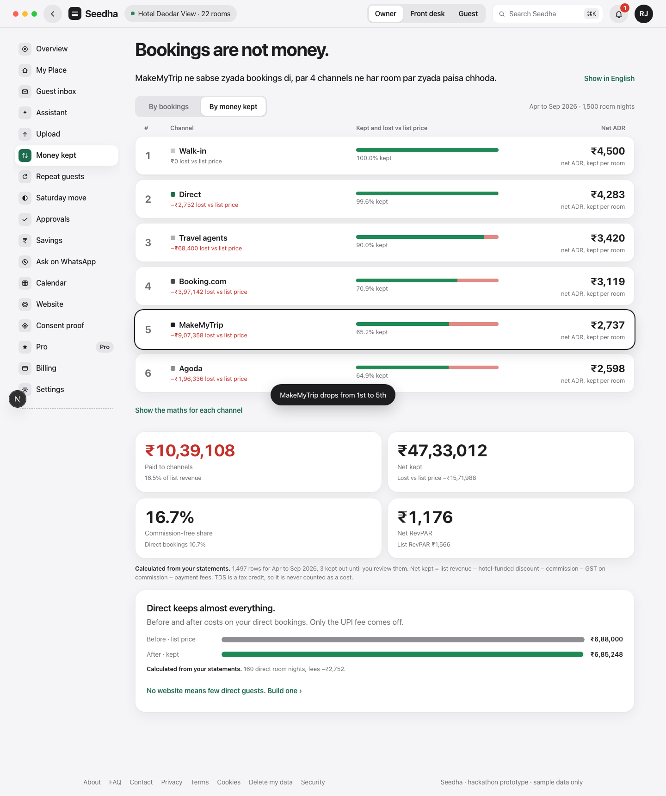
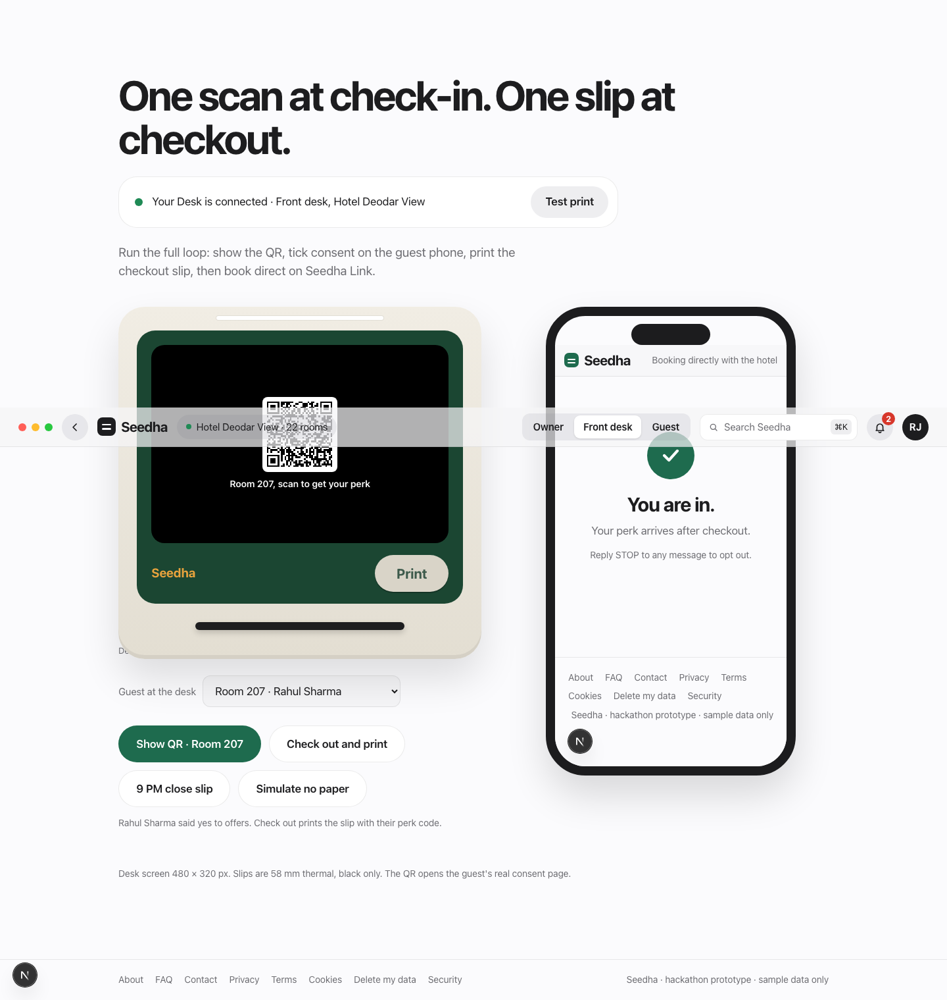
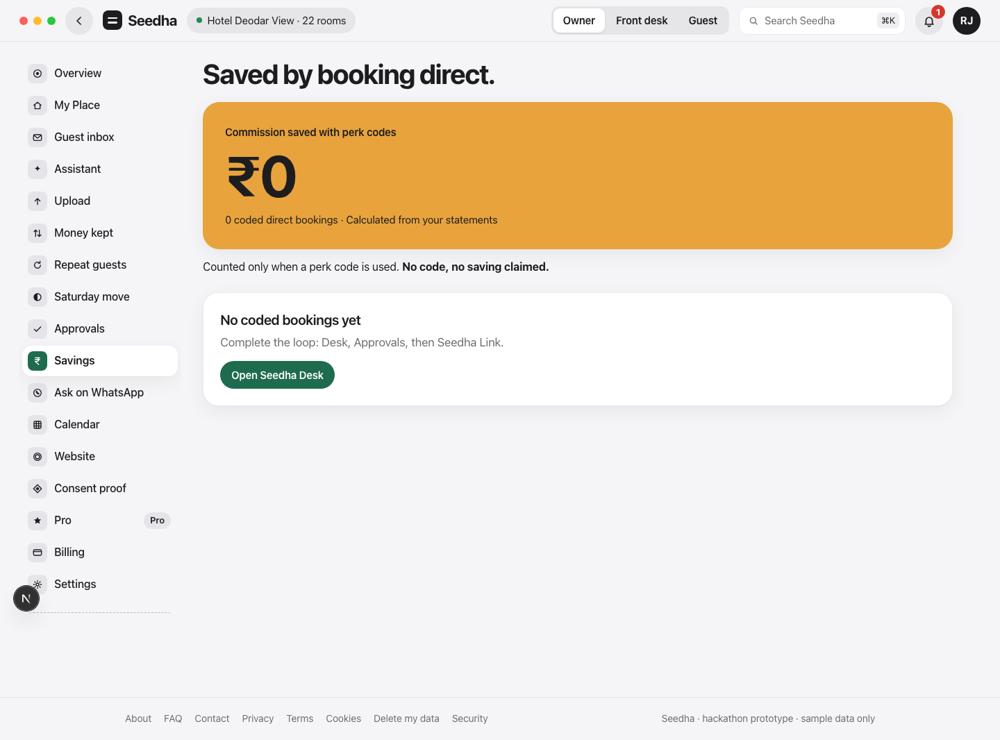
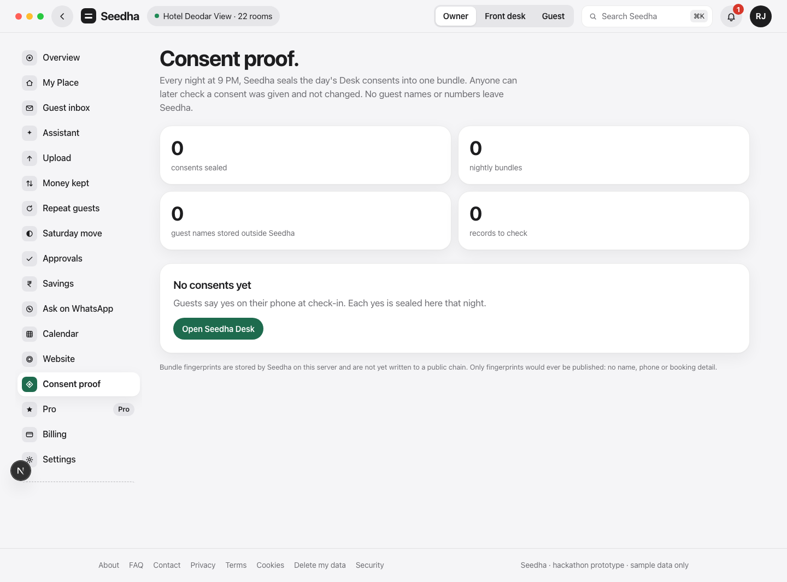
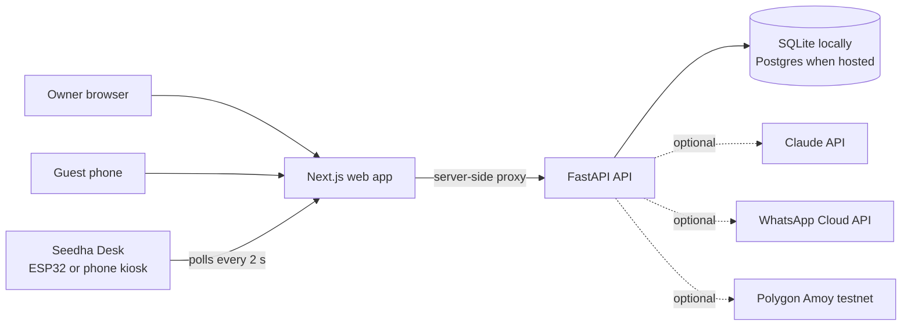

# Seedha

Seedha shows a small hill hotel (10 to 40 rooms, Uttarakhand first) what each
booking channel really leaves it after discount, commission, GST on
commission and payment fees. It finds repeat guests the hotel paid an OTA
for twice, captures guest consent at the front desk, and wins those guests
back to book direct with an owner-approved WhatsApp perk and a direct booking
link with UPI. Built for the TBI GEU AI-Tourism Hackathon, Track D6 (Channel
Mix and Distribution Cost Optimisation). D6 is computation, not prediction,
so every rupee on screen is computed by code from stored rows.

All hotel, guest and booking data in this repo is fictional sample data
(Hotel Deodar View, 22 rooms, April to September 2026).

## The problem

- OTA statements show gross bookings, so owners rank channels by volume and never see what each one actually leaves them.
- Returning guests come back through the same OTA, and the hotel pays commission and GST on them again.
- Owners have no lawful, consented way to reach those guests and no simple direct booking path to offer them.

## Key features

- **Statement upload:** OTA PDFs, Excel and CSV read into one ledger; rows that do not add up within ₹1 are flagged, not counted.
- **The flip:** channels ranked by bookings, then by money kept; MakeMyTrip drops from 1st to 5th on the sample data.
- **Repeat guests:** guests who came back through an OTA, and the commission and GST paid on them twice; the owner confirms each match.
- **Seedha Desk:** a front desk device (ESP32, or a phone at `/desk/device`) shows a consent QR; the box is unticked by default.
- **Checkout slip:** what the hotel kept on the guest's own booking, plus a perk code.
- **Approvals:** win-back drafts that go out only after the owner approves, each ending "Reply STOP to opt out".
- **Seedha Link:** a direct booking page with a perk for returning guests (never a lower rate) and UPI payment.
- **Savings:** commission and GST avoided on each direct booking, minus the UPI fee.
- **Room board:** last night's rooms with each stay's ledger lines, channel filters and a 7-night scrubber.
- **Guest inbox:** consented guests only, suggested replies the owner edits and sends, and a stay invoice built from the booking row.
- **Seedha Site:** the owner adds 4 to 8 photos (HEIC too, resized, location data removed), a typed or spoken description and room prices; AI writes the site text in English and Hindi (3 runs a day, a monthly token cap, never a price or number); the owner reviews with Pine, Stone or Sky and EN or HI, edits, and publishes at `/h/<slug>` or `<slug>.<SITE_ROOT_DOMAIN>`, with Copy, Share on WhatsApp and a QR download.
- **Pulse calendar:** sample town events turned into one channel decision each, plus events the owner pastes from official sources.
- **Consent proof:** each consent becomes a salted SHA-256 fingerprint; a nightly Merkle root can be written to the Polygon Amoy testnet.
- **Pro:** an overcharge audit with dispute drafts, rate floors by channel, group displacement and more, each labelled sample or illustration where it is.

## Screenshots

| Money kept (the flip)                                                                   | Desk consent                                                                           |
| --------------------------------------------------------------------------------------- | -------------------------------------------------------------------------------------- |
|  |  |

| Savings                                                                              | Consent proof                                                                            |
| ------------------------------------------------------------------------------------ | ---------------------------------------------------------------------------------------- |
|  |  |

## Architecture



- **Web:** Next.js (App Router, TypeScript, Tailwind) for the owner app, the guest pages and the public website. The browser talks only to the web app, which proxies to the API.
- **API:** Python, FastAPI, SQLAlchemy 2 and Alembic. Money is integer paise internally and formatted with Indian grouping only at the edge.
- **Database:** SQLite for the local demo; Postgres when hosted (Railway), chosen by `DATABASE_URL`. The full API suite runs on both in CI.
- **Desk:** ESP32 firmware (PlatformIO) with a TFT screen, QR, LED ring and thermal printer; a phone or tablet can stand in at `/desk/device`.
- **AI:** Claude reads unfamiliar statement layouts, breaks name-match ties, drafts message wording and writes hotel site text. It never produces a money figure; code checks every amount.

## What is real and what is simulated

| Part                                                           | Status                                                                                                                                                                                                                               |
| -------------------------------------------------------------- | ------------------------------------------------------------------------------------------------------------------------------------------------------------------------------------------------------------------------------------ |
| Ledger, net kept per channel, the flip, repeat guests, savings | Real: computed by code from the stored sample rows                                                                                                                                                                                   |
| Statement parsing for CSV and Excel                            | Real                                                                                                                                                                                                                                 |
| Statement parsing for PDFs and unknown layouts                 | Claude when a key is set, for the owner; hosted and public-link visitors get the labelled fallback; otherwise the sample statements are read from known layouts                                                                      |
| Consent capture, salted fingerprints, Merkle roots             | Real                                                                                                                                                                                                                                 |
| Proof write to a public chain                                  | Polygon Amoy testnet only, when a funded testnet wallet, RPC and `PROOF_CHAIN_ID=80002` are set; otherwise stored locally and labelled "Local only"                                                                                  |
| WhatsApp messages                                              | Simulated send log unless WhatsApp Cloud API keys are set                                                                                                                                                                            |
| UPI payment on Seedha Link                                     | Simulated (labelled); no payment gateway is connected                                                                                                                                                                                |
| Message drafts and event reading                               | Claude when a key is set, for the owner; fixed templates and a labelled sample extraction otherwise (hosted and public-link visitors always get these)                                                                               |
| Seedha Site text                                               | Claude only when `SITE_GEN_MODEL` and `ANTHROPIC_API_KEY` are set; otherwise text from the owner's own words, labelled Sample. Hosted, the sample hotel's public page always shows the fixed sample page and visitors cannot publish |
| Stay invoice PDF                                               | Real, built from the booking row; marked Sample for the sample hotel                                                                                                                                                                 |
| Hotel, guests, bookings, events, second property               | Fictional sample data, labelled                                                                                                                                                                                                      |
| Seedha Desk hardware                                           | Firmware builds and its tests pass; the phone kiosk works today                                                                                                                                                                      |

No OTA website is scraped. Guest contacts from OTAs are never stored or
messaged; only guests who said yes at the Desk can be messaged.

## How to run it

After a one-time `make setup` (see [README-dev.md](README-dev.md)):

```bash
make demo-prod
```

Open http://localhost:3000/login and tap **Direct beta login**. That opens
the fictional sample hotel with no code. The demo listens on localhost
only.

The 8-step demo path (Home shows "0 of 8 done"):

1. **Upload:** "Use sample statements". 1,500 rows matched, 3 flagged for review.
2. **The flip:** paid to channels ₹10,39,108; switch to "By money kept" and MakeMyTrip falls from 1st to 5th (₹2,737 kept per room night).
3. **Repeat guests:** 12 guests, ₹41,800 of commission and GST paid twice.
4. **Desk consent:** on Desk pick room 207 and "Show QR"; on the guest phone tick the box and agree.
5. **Checkout slip:** "Check out and print" shows what the hotel kept and the perk code **DEODAR-RS26**.
6. **Approve:** approve the win-back draft on Approvals.
7. **Direct booking:** open `/link/DEODAR-RS26`, book with simulated UPI. The code works once.
8. **Savings:** ₹2,233 commission and GST avoided, ₹2,199 net after the UPI fee. Home shows "8 of 8 done".

For phones on the same Wi-Fi use `make demo-lan`, and for a public link
`make demo-live` (needs `cloudflared`). Both use fresh secrets for every
run and keep reset, Claude and testnet writes on the laptop.

## Tests and quality

`make check` runs every gate:

- **API:** 1,308 pytest tests, about 98% coverage overall and 100% on money code, mypy strict, pylint 9.98, bandit and pip-audit clean.
- **Web:** TypeScript strict, ESLint with zero warnings, Prettier, 205 unit tests, npm audit gate.
- **End to end:** 78 Playwright tests, including the full 8-step loop, accessibility (axe) in light and dark at phone and laptop widths, and a speed check on the flip.
- **Secrets:** a scan of the whole git history.
- **Firmware:** native tests and a device build.

The locked sample numbers (₹10,39,108 paid to channels, MakeMyTrip ₹2,737
net per room night, direct ₹4,283, total net ₹47,33,012) are asserted in
tests. The flip speed check needs a quiet machine: under heavy load from
other apps it can exceed its 1 second budget.

## Roadmap

All planned; none of these are live.

- **Seedha Pass (planned):** one network of owner-run hill hotels, with perks at every member hotel and a guest profile shared only with the guest's separate consent.
- **Event Radar (planned):** upcoming local events from official sources only, with one morning WhatsApp line for the owner. Owner-pasted events work today as a first step.
- **Seedha Credit (planned):** scope still to be defined. Nothing is designed or built yet.

## For developers

Setup, environment variables, the full demo script, the manual checklist
for the live features and troubleshooting are in
[README-dev.md](README-dev.md).
